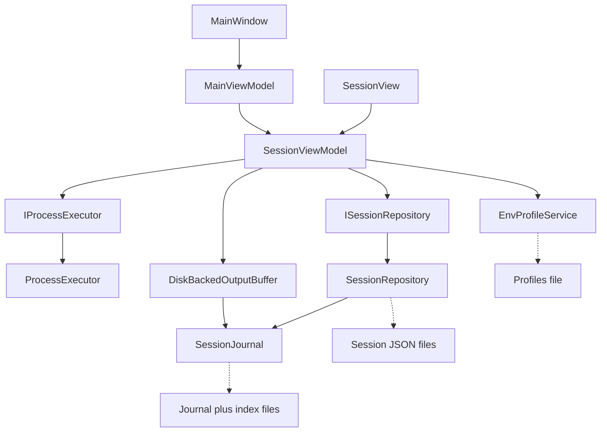
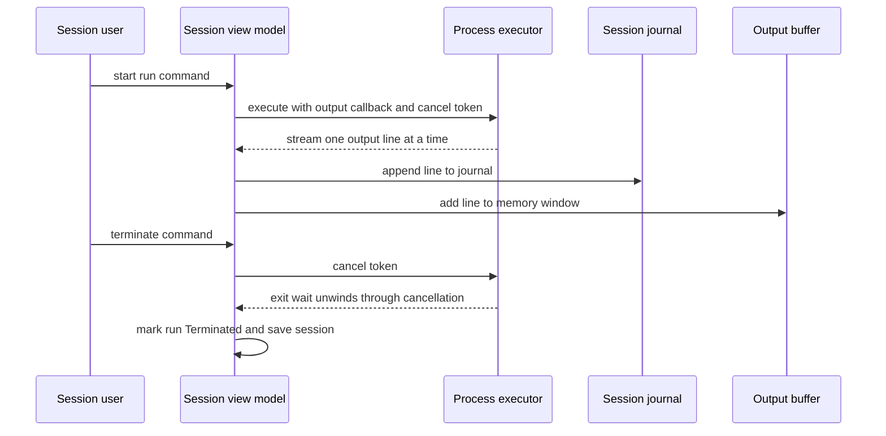
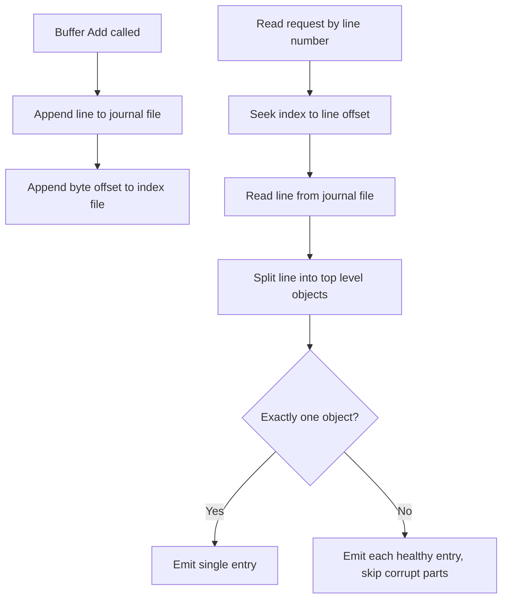
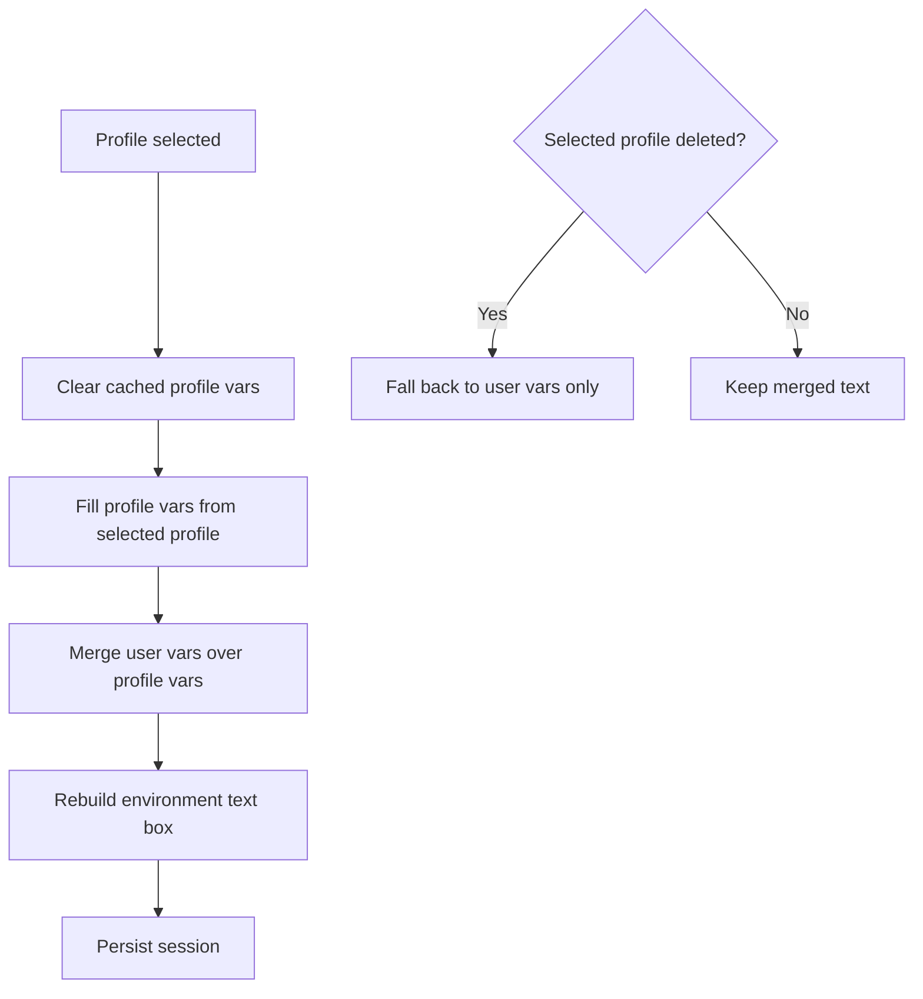

# CommandPrompts

A Windows desktop application for defining, running, and persisting multiple command-prompt sessions. Each session captures a command, arguments, working directory, and environment variables; output is streamed live, journaled to disk, and run history is stored locally as JSON. Sessions support interactive stdin, shared env profiles, and explicit terminated status.

Built on .NET 10 and **Avalonia 12** (migrated from WPF). Includes a headless NUnit test suite.

## Architecture

Two-project solution following Clean Architecture (the legacy WPF project was removed; Avalonia is the only UI):

```
src/
  CommandPrompts.Core/           Platform-neutral domain and services
  CommandPrompts.App.Avalonia/   Avalonia 12 presentation (MVVM) — active
tests/
  CommandPrompts.App.Avalonia.Tests/  Headless NUnit tests (Avalonia.Headless)
```

### CommandPrompts.Core

No UI framework dependency (`net10.0`, `IsAotCompatible=true`):

- `Abstractions/` — `IProcessExecutor`, `ISessionRepository`. The App layer depends only on these interfaces.
- `Models/` — `Session`, `ExecutionRecord`, `OutputEntry`, `EnvironmentVariable`, `EnvProfile`.
- `Services/` — implementations:
  - `ProcessExecutor` — async process lifecycle via `TaskCompletionSource` + event-based exit; returns the real process `ExitCode`, validates command/working-directory before start, redirects stdin (via `onStdinReady` callback), kills with a broad catch so termination can never escape, waits via cancellation-linked `WaitAsync(ct)` plus `WaitForExitAsync` for output flush.
  - `SessionRepository` — file-per-session JSON persistence under `%LOCALAPPDATA%\CommandPrompts\History`; each save writes a uniquely-named temp file and holds the `ioLock` across serialize+write+move for atomic, collision-free replacement; owns one cached `SessionJournal` per session (single writer) with `CloseJournal` for handle release; dispose-first ordering in `DeleteAsync`; implements `IDisposable`; skips corrupt JSON files at load time.
  - `SessionJournal` — crash-safe append-only newline-delimited JSON output log with a line-offset index for O(1) random access; opened `OpenOrCreate` + seek-to-end (Append mode forbids truncation); shared `ParseJournalLine` salvage parser recovers healthy entries from fused/corrupt lines.
  - `EnvProfileService` — named env-var profiles in `%LOCALAPPDATA%\CommandPrompts\Profiles.json` (atomic temp+move writes); `GetEffectiveVars` merges profile base with session overrides (session wins).
  - `DebouncedAction` — UI-thread-safe save debouncing with a `FlushAsync` for deterministic final writes.

Dependency direction is strictly one-way: App → Core abstractions → implementations.

### CommandPrompts.App.Avalonia

The active UI layer, using **Avalonia 12** with `CommunityToolkit.Mvvm` source generation:

- **ViewModels** — `MainViewModel` (session lifecycle, Dispatcher marshaling for UI-thread collection updates, profile editor entry point), `SessionViewModel` (run/terminate with explicit `Terminated` status/clear/copy/multi-select, stdin submit with password masking, profile/user var split with deleted-profile fallback), `ProfileEditorViewModel` (dispatcher-free profile CRUD + name validation), `DiskBackedOutputBuffer` (virtualized disk-backed output with sliding memory window; implements non-generic `IList` for ItemsControl binding), `OutputLineViewModel` (immutable, color-coded console output).
- **Views** — `MainWindow` (toolbar + horizontal WrapPanel session strip + detail panel), `SessionView` (config panel + virtualized console output with bottom-follow auto-scroll + input panel), `ConfirmDialog`, `ProfileEditorDialog` (profile list + name/vars editor).
- **Services** — `IDialogService`, `IClipboardService` (Avalonia 12 `DataTransfer` API), `IProcessLauncher` — injected via `AttachServices` after construction (no DI container).
- **Themes** — `AppTheme.axaml` (13-color dark console palette + brushes, merged via `ResourceInclude`), `AppStyles.axaml` (control styles, merged via `StyleInclude`).
- **Logging** — `AvaloniaTraceListener` bridges Avalonia `LogToTrace` → ZLogger rolling file under `%LOCALAPPDATA%\CommandPrompts\logs`.

### CommandPrompts.App

Removed — the legacy WPF implementation was deleted and Avalonia is the only UI. For history: it used hand-rolled MVVM with a local `ObservableObject` base and `RelayCommand`, and the Avalonia port preserves its behaviors (history replay, session CRUD) 1:1.

## Diagrams

### Layer map



### Run and terminate sequence



### Journal write, read, and salvage



### Profile merge on selection change



## Engineering Constraints

All code targets the requirements in `resources/Project-Requirements.md`:

- Minimal CPU / memory / IO consumption
- Zero allocation where practical
- Reflection-free serialization (source-generated JSON)
- Thread safety
- Fully async, non-blocking execution

Concrete expressions:

- **Source-generated JSON**: all serialization goes through `[JsonSerializable]` types in `Core/Json/AppJsonContext.cs`. New model types must be registered there. No reflection-based `JsonSerializer` calls.
- **AOT compatibility**: Core sets `IsAotCompatible`; avoid APIs requiring runtime code generation.
- **Async throughout**: process execution is event-driven with `CancellationToken` propagation; file IO is asynchronous.
- **Explicit locking**: shared state in services is protected by `System.Threading.Lock`, not legacy monitor patterns.
- **Compiled bindings**: Avalonia uses `x:DataType` on all `DataTemplate` roots and `UserControl`/`Window` roots. Wrong property paths fail at build time (AVLN2000), not runtime.

## Build & Run

Requires the .NET 10 SDK.

```bash
dotnet build CommandPrompts.slnx
dotnet run --project src/CommandPrompts.App.Avalonia
```

The solution file is `.slnx` format. Code style is enforced at build time for the Core project (`EnforceCodeStyleInBuild`); both projects compile with `AnalysisLevel=latest-all` and nullable reference types enabled.

### NuGet Dependencies

- **Core**: none beyond BCL.
- **Avalonia**: `Avalonia`, `Avalonia.Desktop`, `Avalonia.Themes.Fluent`, `CommunityToolkit.Mvvm`, `ZLogger`.
- **Tests**: `Avalonia.Headless.NUnit`, `NUnit`.

## Tests

```bash
dotnet test tests/CommandPrompts.App.Avalonia.Tests
```

Uses `Avalonia.Headless.NUnit` with `PerTest` isolation. Tests are `async Task` awaiting `ExecuteAsync` for deterministic dispatcher pumping. Coverage: load persistence, view binding, run loop exit codes, history replay, idempotent loads, stdin round-trip, crash-safe journaling, fused-line salvage, profile CRUD/validation/fallback, terminate-to-Idle, delete with open journal.

## Conventions

- Naming: camelCase private fields, PascalCase types; no underscores anywhere.
- Sealed classes by default; interfaces defined in Core before implementation.
- ViewModels are `sealed`, implement `IDisposable` when they own processes or timers.
- MVVM via `CommunityToolkit.Mvvm` source generation: `[ObservableProperty]`, `[RelayCommand]`, `[NotifyPropertyChangedFor]`.
- DI without container: dependencies injected via constructor; view-layer services attached post-construction.
- JSON: source-generated serializer via `[JsonSerializable]` context in `Core/Json/AppJsonContext.cs`.
- Avalonia threading: `Dispatcher.UIThread.InvokeAsync` for UI-thread result marshaling; `Dispatcher.UIThread.Post` for fire-and-forget UI updates from background callbacks.
- Session history persists as JSON files in `%LOCALAPPDATA%\CommandPrompts\History` (one file per session, write-once temp file per save, atomic replace).

## Pitfalls

- Solution file is `.slnx` (new format) — pass it explicitly to `dotnet` commands; older tooling may not parse it.
- Never hand-edit `bin/`, `obj/`, or `History/*.json`.
- `resources/notes.md` is the user's scratch task list, not app documentation.
- Avalonia `<Style>` elements cannot live directly inside a merged `<ResourceDictionary>` — they require a separate `<Styles>` file included via `StyleInclude`.
- `WrapPanel` in `ItemsControl.ItemsPanel` does not virtualize — acceptable for small collections (sessions), but use `ItemsRepeater` with `UniformGridLayout` for large data sets.
- `ScrollViewer` must have a constrained parent (`Grid`, `MaxHeight`); placing it inside infinite-height panels disables overflow detection.
- `VerticalScrollBarVisibility` is a WPF property — Avalonia's `TextBox` does not expose it; use `ScrollViewer` wrappers instead.
- Headless tests must `await ExecuteAsync` (not `RunJobs`) for posted dispatcher work to complete.
- `ItemsControl` requires collections to implement non-generic `System.Collections.IList` alongside `INotifyCollectionChanged` — generic `IList<T>` alone leaves `ItemsSource` unbound.
- `FileMode.Append` forbids `SetLength(0)` — truncatable append streams need `OpenOrCreate` + `Seek(End)`.
- Auto-scroll follow flags must be recalculated from current scroll position on every `ScrollChanged`; gating on `ExtentDelta` latches the flag permanently.
- Journal files assume a single writer — concurrent app instances sharing `%LOCALAPPDATA%\CommandPrompts\History` can fuse lines (the salvage parser recovers complete values only).

## License

See [LICENSE](LICENSE).
